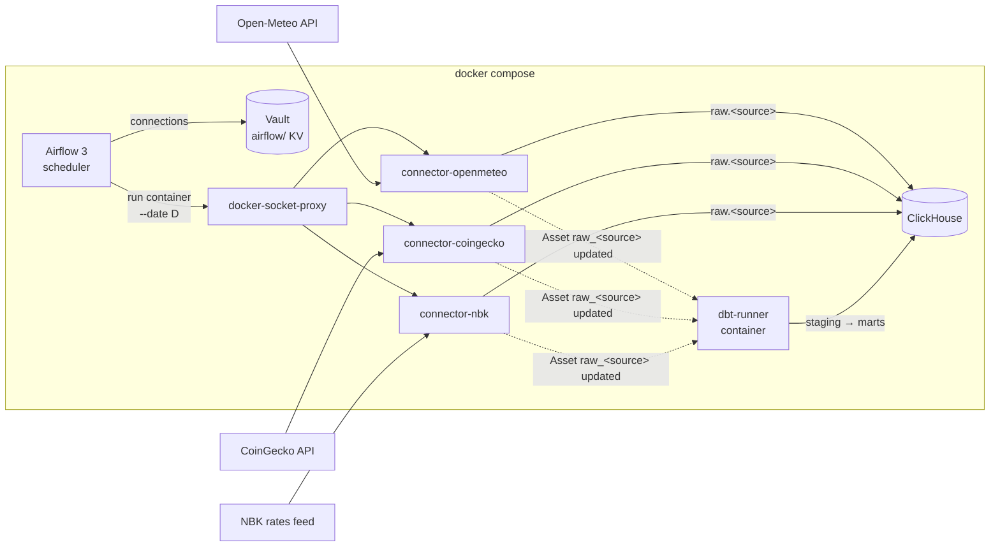

# api-to-dwh

Containerized API connectors that land raw data into a ClickHouse DWH, orchestrated by Airflow,
with credentials stored in HashiCorp Vault.

Each source is an independent connector with its own Docker image. Airflow only knows the image
name and the date to load. It does not install connector dependencies or run connector code in
its own process.

Three sources (weather, crypto prices, official exchange rates) flow through
`raw` (append-only JSON) → `staging` (deduplicated, typed) → `marts` (business tables).
For example, `marts.fct_crypto_prices_kzt` joins CoinGecko prices with the National Bank of
Kazakhstan USD rate to price coins in tenge.

## Connectors

| Connector | Source | Format | Record key | Secret |
|---|---|---|---|---|
| `openmeteo` | [Open-Meteo](https://open-meteo.com/) daily + hourly weather for Kazakhstan cities | JSON | city | none |
| `coingecko` | [CoinGecko](https://www.coingecko.com/en/api) coin history (price, market cap, volume) | JSON | coin id | optional demo key from Vault |
| `nbk` | [National Bank of Kazakhstan](https://nationalbank.kz/) official KZT exchange rates | XML (parsed with `defusedxml`) | currency code | none |

## Architecture



- **One image per source.** A connector is a small Python package + Dockerfile. Its dependencies
  never touch the Airflow environment.
- **DAGs are generated** from `airflow/dags/connectors.yaml`. A new source is an image plus one line.
- **Secrets live in Vault.** Airflow uses `VaultBackend` with a read-only token limited to the
  `airflow/` mount and passes credentials to the container as env vars. They are masked (`***`) in
  task logs and in the rendered templates view.
- **No raw Docker socket in Airflow.** Containers are started through `docker-socket-proxy`, which
  only allows the container and image API.
- **dbt is event-driven.** Each load task publishes an Airflow Asset `raw_<source>`; the
  `dbt_build` DAG is scheduled on those Assets, so marts are rebuilt right after any load instead
  of at a guessed cron time.

## dbt models

| Layer | Model | Materialization | What it does |
|---|---|---|---|
| staging | `stg_openmeteo__daily` | view | latest batch per city/day, daily weather as typed columns |
| staging | `stg_coingecko__prices` | view | latest batch per coin/day, USD price, market cap, volume |
| staging | `stg_nbk__rates` | view | latest batch per currency/day, KZT rate per 1 unit (`quant` normalized) |
| marts | `fct_crypto_prices_kzt` | table | coin prices in USD and KZT at the official NBK rate of the same day |
| marts | `fct_city_weather` | table | daily weather with a 7-day rolling average temperature |

Deduplication is a single macro (`macros/latest_batch.sql`, `argMax(payload, _loaded_at)`), so
re-runs and backfills of the raw layer are safe. Tests: `unique`/`not_null` keys, accepted
values, a singular test that rates are positive, and source freshness (warn after 2 days,
error after 4).

## Quick start

Requires Docker Desktop (or Docker Engine) and [uv](https://docs.astral.sh/uv/).

```bash
cp .env.example .env        # then replace every change-me value
for c in openmeteo coingecko nbk; do
  docker build -f connectors/$c/Dockerfile -t connector-$c:dev .
done
docker build -f dbt/Dockerfile -t dbt-runner:dev .
docker compose up -d
```

| Service | URL |
|---|---|
| Airflow UI (no login, local only) | http://localhost:8080 |
| ClickHouse HTTP | http://localhost:8123 |
| Vault UI (root token from `.env`) | http://localhost:8200 |

Unpause the `load_*` DAGs and `dbt_build` in the UI, or trigger a specific day:

```bash
docker compose exec airflow-scheduler \
  airflow dags trigger load_nbk --conf '{"date": "2026-10-17"}'
```

When the load finishes, `dbt_build` starts on its own. Check the result:

```sql
SELECT price_date, symbol, round(price_usd, 2) AS usd, round(price_kzt) AS kzt
FROM marts.fct_crypto_prices_kzt
ORDER BY price_date, price_usd DESC;
```

Vault runs in dev mode (in memory). `vault-init` seeds it on every `docker compose up`, see
`infra/vault/init.sh`. In production use a persistent Vault with AppRole or Kubernetes auth.

## CI/CD

| Workflow | Trigger | What it does |
|---|---|---|
| `ci.yml` | every PR and push to `main` | ruff, mypy (strict), pytest; validates `docker-compose.yaml`; imports all DAGs in a clean Airflow 3.3 container |
| `connectors.yml` | changes in `connectors/`, `libs/`, lock files | builds an image per **changed** connector (a change in `libs/` rebuilds all), runs a smoke test, and on `main` pushes to GHCR |
| `dbt.yml` | changes in `dbt/` | builds the dbt runner image, runs `dbt parse` inside it, and on `main` pushes `ghcr.io/<owner>/dbt-runner` |

Published tags: `ghcr.io/<owner>/connector-<name>:latest`, `:<version>` from the connector's
`pyproject.toml`, and `:sha-<commit>`. To run the stand on published images instead of local
builds, set in `.env`:

```bash
CONNECTOR_IMAGE_TEMPLATE=ghcr.io/<owner>/connector-{name}:latest
```

## Layout

```
libs/dwh-common/         shared runtime: HTTP retries, ClickHouse raw writer, CLI runner
connectors/openmeteo/    Open-Meteo daily weather -> raw.openmeteo
connectors/coingecko/    CoinGecko coin history -> raw.coingecko
connectors/nbk/          NBK official exchange rates -> raw.nbk
airflow/dags/            connector DAG factory, dbt_build DAG, connectors.yaml
dbt/                     dbt project (staging, marts, tests) + runner Dockerfile
infra/vault/init.sh      Vault seeding: KV mount, DWH connection, read-only policy and token
.github/workflows/       CI and per-connector image builds
docker-compose.yaml      local stand
```

## Raw layer contract

Every connector writes to `raw.<source>` with the same schema:

| column | meaning |
|---|---|
| `_batch_id` | UUID of the run |
| `_loaded_at` | load timestamp, UTC |
| `_source` | connector name |
| `_partition_date` | logical date that was loaded |
| `_record_key` | business key of the object (e.g. city) |
| `payload` | the API object as JSON, untouched |

The raw layer is append-only. Re-runs and backfills add new batches. Deduplication
(latest `_loaded_at` per `_partition_date` + `_record_key`) happens in staging models.

## Connector development

```bash
uv sync --all-packages
uv run pytest
uv run ruff check . && uv run ruff format --check .
uv run mypy libs/dwh-common/src connectors/*/src

# call the real API without touching ClickHouse
uv run connector-openmeteo --date 2026-10-17 --dry-run
```

A connector reads ClickHouse settings from `CH_HOST`, `CH_PORT`, `CH_USER`, `CH_PASSWORD`,
`CH_DATABASE` (default `raw`). Open-Meteo locations can be overridden with
`OPENMETEO_LOCATIONS='[{"name": "almaty", "latitude": 43.24, "longitude": 76.89}]'`.
