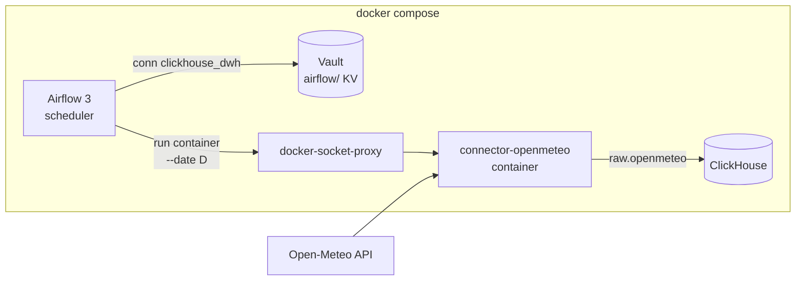

# api-to-dwh

Containerized API connectors that land raw data into a ClickHouse DWH, orchestrated by Airflow,
with credentials stored in HashiCorp Vault.

Each source is an independent connector with its own Docker image. Airflow only knows the image
name and the date to load. It does not install connector dependencies or run connector code in
its own process.

> Work in progress. Done: shared runtime, Open-Meteo connector, local stand
> (Airflow 3 + ClickHouse + Vault), CI/CD to GHCR. Next: more connectors, dbt staging.

## Architecture



- **One image per source.** A connector is a small Python package + Dockerfile. Its dependencies
  never touch the Airflow environment.
- **DAGs are generated** from `airflow/dags/connectors.yaml`. A new source is an image plus one line.
- **Secrets live in Vault.** Airflow uses `VaultBackend` with a read-only token limited to the
  `airflow/` mount and passes credentials to the container as env vars. They are masked (`***`) in
  task logs and in the rendered templates view.
- **No raw Docker socket in Airflow.** Containers are started through `docker-socket-proxy`, which
  only allows the container and image API.

## Quick start

Requires Docker Desktop (or Docker Engine) and [uv](https://docs.astral.sh/uv/).

```bash
cp .env.example .env        # then replace every change-me value
docker build -f connectors/openmeteo/Dockerfile -t connector-openmeteo:dev .
docker compose up -d
```

| Service | URL |
|---|---|
| Airflow UI (no login, local only) | http://localhost:8080 |
| ClickHouse HTTP | http://localhost:8123 |
| Vault UI (root token from `.env`) | http://localhost:8200 |

Unpause `load_openmeteo` in the UI, or trigger a specific day:

```bash
docker compose exec airflow-scheduler \
  airflow dags trigger load_openmeteo --conf '{"date": "2026-10-17"}'
```

Check the result:

```sql
SELECT _record_key, _loaded_at,
       JSONExtractFloat(payload, 'daily', 'temperature_2m_max', 1) AS t_max
FROM raw.openmeteo
WHERE _partition_date = '2026-10-17';
```

Vault runs in dev mode (in memory). `vault-init` seeds it on every `docker compose up`, see
`infra/vault/init.sh`. In production use a persistent Vault with AppRole or Kubernetes auth.

## CI/CD

| Workflow | Trigger | What it does |
|---|---|---|
| `ci.yml` | every PR and push to `main` | ruff, mypy (strict), pytest; validates `docker-compose.yaml`; imports all DAGs in a clean Airflow 3.3 container |
| `connectors.yml` | changes in `connectors/`, `libs/`, lock files | builds an image per **changed** connector (a change in `libs/` rebuilds all), runs a smoke test, and on `main` pushes to GHCR |

Published tags: `ghcr.io/<owner>/connector-<name>:latest`, `:<version>` from the connector's
`pyproject.toml`, and `:sha-<commit>`. To run the stand on published images instead of local
builds, set in `.env`:

```bash
CONNECTOR_IMAGE_TEMPLATE=ghcr.io/<owner>/connector-{name}:latest
```

## Layout

```
libs/dwh-common/         shared runtime: HTTP retries, ClickHouse raw writer, CLI runner
connectors/openmeteo/    Open-Meteo daily weather -> raw.openmeteo
airflow/dags/            DAG factory + connectors.yaml
infra/vault/init.sh      Vault seeding: KV mount, DWH connection, read-only policy and token
.github/workflows/       CI and per-connector image builds
docker-compose.yaml      local stand
```

## Raw layer contract

Every connector writes to `raw.<source>` with the same schema:

| column | meaning |
|---|---|
| `_batch_id` | UUID of the run |
| `_loaded_at` | load timestamp, UTC |
| `_source` | connector name |
| `_partition_date` | logical date that was loaded |
| `_record_key` | business key of the object (e.g. city) |
| `payload` | the API object as JSON, untouched |

The raw layer is append-only. Re-runs and backfills add new batches. Deduplication
(latest `_loaded_at` per `_partition_date` + `_record_key`) happens in staging models.

## Connector development

```bash
uv sync --all-packages
uv run pytest
uv run ruff check . && uv run ruff format --check .
uv run mypy libs/dwh-common/src connectors/openmeteo/src

# call the real API without touching ClickHouse
uv run connector-openmeteo --date 2026-10-17 --dry-run
```

A connector reads ClickHouse settings from `CH_HOST`, `CH_PORT`, `CH_USER`, `CH_PASSWORD`,
`CH_DATABASE` (default `raw`). Open-Meteo locations can be overridden with
`OPENMETEO_LOCATIONS='[{"name": "almaty", "latitude": 43.24, "longitude": 76.89}]'`.
